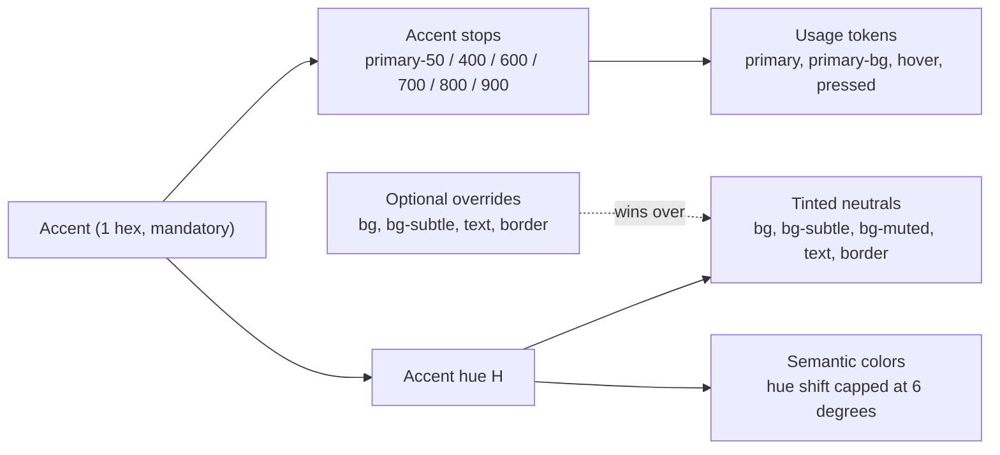
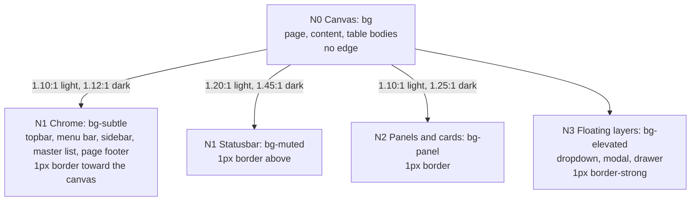

# Design System - v2.1 (Electron)

> Binding reference for all Node.js/Electron/React applications.
> Use: Windows desktop applications, personal and professional use.
> Inseparable from `layout.md` (v4.2).
> All tokens are **CSS custom properties** declared in `src/renderer/src/styles/tokens.css`.

**Visual language (v2.1)**: depth is expressed by the **stroke** (borders) and by a **four-level surface ladder** (fills spaced widely enough to be seen), never by shadows or elevation. Corners are softly rounded (5px). Neutrals carry a low tint of the project accent, so every generated application has its own atmosphere. Motion is discreet (asymmetric deceleration) with **one** signature gesture: the sliding underline on tabs and horizontal navigation. Every state is readable without color alone, and every text and control pair is measured against WCAG 2.1 AA.

## Changelog

| Version | Date       | Main change |
| ------- | ---------- | ----------- |
| v2.1    | 2026-10-25 | **surface ladder** N0-N3 (canvas / chrome / panel / floating) with wider fill steps · new token `--bg-panel` · neutral hex recomputed (`--bg`, `--bg-subtle`, `--bg-muted`, `--bg-elevated`, `--border`, `--border-subtle`, `--border-strong`, `--text-subtle`) · **accent AA darkening**: `--primary-600` is darkened until white text, text on `--bg` and text on `--primary-50` reach 4.5:1 (default `#4682B4` → `#3D729E`); `--primary-700/800` re-derived from it · new token `--danger-fill` · topbar and menu bar on `--bg-subtle`, modal on `--bg-elevated` · control edge (field, Secondary button) = `--border-strong` · neutral hover step transparent → `--border-strong` · selected items carry a 2px `--primary` bar (no color-only state) · pagination label and tree chevrons `--text-subtle` · font sizes in `rem` · new size tokens (`--toast-width`, `--modal-min-width`, `--sidebar-width`, `--master-width`, `--menubar-height`, `--menu-min-width`) · `--duration-*` tokens added next to `--transition-*` · accessibility behaviors (focus floor, forced colors, universal reduced motion, `color-scheme`) |
| v2.0    | 2026-07-16 | modernization: `--radius` 0 → **5px** · typography → **system-ui** stack · **accent-tinted neutrals** (all neutral roles derived from the accent hue; explicit palette roles still win) · **semantic colors derived per project** (fixed hue anchors, harmonized ±6° toward the accent; info = accent) · hover on neutral elements = **border strengthening** (replaces `--bg-muted` fill) · new easing `--ease-out` (decelerate) 160/240ms · **signature gesture**: sliding underline (tabs / horizontal nav) · icons Font Awesome → **Lucide** (stroke 1.75px); `--icon-*` now consume semantic/primary tokens · floating layers marked by `--border-strong` (shadows still forbidden) |
| v1.6    | 2026-06-27 | default accent → **Steel Blue** `#4682B4` (chromatic in both themes, derived like the named palettes) · dark **surfaces** stay neutral grey · `--text-on-primary` stays a single white value · Teal kept as a named palette |
| v1.5    | 2026-06-20 | default accent → **Teal** `#0D9488` · dark surfaces stay neutral grey · grey-accent dark special-case removed |
| v1.4    | 2026-06-20 | decouple Danger button text from the accent: new fixed `--text-on-danger` |
| v1.3    | 2026-06-19 | full **palette** model (5 roles/theme) · named palette catalog + custom palette · WCAG AA check (warn) |
| v1.2    | 2026-06-14 | dark theme re-skin: 4-step dark surface ramp · Steel Blue primary (both modes) |
| v1.1    | 2026-06-14 | line-height · dark semantic backgrounds · `color-scheme` · WCAG AA target · layering scale |
| v1.0    | initial    | CSS custom properties port: typography, colors, spacing, components, states |

> The Python generator `design-system.md` and the Flutter version were aligned with v2.0 (shared palette and derivation model). They are **not** updated by v2.1: the neutral values, the accent AA darkening, `--bg-panel` and `--danger-fill` below differ from theirs until they are aligned. Per-file versions: CSS rules in `rules/css.md`, layout in `layout.md`.

Every generated application references the active version in its `README.md`.

## Deviations from v2.0

Each row is a value or rule of v2.0 that v2.1 replaces, with the measured reason.

| Area | v2.0 | v2.1 | Reason |
| ---- | ---- | ---- | ------ |
| `--primary-600` | `#4682B4` (the accent) | `#3D729E` (accent darkened, L 49 → 43) | white text, `--primary` on `--bg` and on `--primary-50` reach 4.5:1 (were 4.11, 4.07, 3.67) |
| `--primary-700`, `--primary-800` | L≈50 and L≈42 | `--primary-600` minus 3 and 6 L | hover was invisible and lower in contrast than the resting state |
| `--text-subtle` | `#65717B` / `#94A2AD` | `#5A6670` / `#A3AEB8` | 4.5:1 on statusbar, toast and selected surfaces (were 4.41 to 4.47) |
| `--border-strong` | `#96A4B0` / `#52626F` | `#6F8192` / `#768A9B` | 3:1 on every surface, `--bg-muted` included (was 2.5:1) |
| Neutral surfaces | light `#FDFEFF`, `#F5F8FA`, `#EEF1F4`; dark `#181C20`, `#20272C`, `#293138`, `#252C32` | light `#FFFFFF`, `#F1F4F7`, `#E6EBF0`; dark `#111519`, `#1A2025`, `#2B343C`, `#222930` (`--bg`, `--bg-subtle`, `--bg-muted`, dark `--bg-elevated`) | fills were 1.06 to 1.13:1 apart and merged; wider steps carry the surface ladder |
| `--border`, `--border-subtle` | light `#E1E6EA`, `#ECF0F3`; dark `#323B43`, `#272F35` | light `#D3DAE1`, `#E3E8ED`; dark `#3A444D`, `#2A333A` | `--border` on `--bg` was 1.24:1 and 1.50:1, now 1.41:1 and 1.85:1 |
| `--bg-panel` | not defined | `--bg-subtle` light, `--bg-elevated` dark | panel and card level N2 needs a different step per theme |
| Topbar and menu bar fill | `--bg` | `--bg-subtle` | chrome sits one level above the canvas |
| Modal fill | `--bg` | `--bg-elevated` | floating layer level N3; identical in light, one step lighter in dark |
| Danger fill | `--danger-600` (light value in both themes, by prose) | token `--danger-fill` = light `--danger-600` | the dark `--danger-600` (`#CB7282`) fails white text; a named token removes the ambiguity |
| Control edge | `--border` | `--border-strong` | WCAG 1.4.11: field and Secondary button boundary (was 1.24:1) |
| Neutral hover step | transparent → `--border` | transparent → `--border-strong`; bordered control → `--text-subtle` | the system's own 3:1 hover rule |
| Selected item | background and text color | plus a 2px `--primary` bar (leading edge; bottom edge for pagination) | WCAG 1.4.1: no color-only state |
| Pagination label, tree chevrons | `--text-muted` | `--text-subtle` | informational text and functional icons are not exempt from AA |
| Font sizes | px | `rem` (same pixels at a 16px root) | follow the user's base font size |
| Tabs semantics | not specified | `<nav>` of buttons with `aria-current="page"` | no tab panel is switched in place |

---

## 1. TYPOGRAPHY

| Token               | Value                | Usage                         |
| ------------------- | -------------------- | ----------------------------- |
| `--font-family`     | system-ui            | All applications              |
| `--font-xs`         | 0.75rem (12px)       | Statusbar, secondary labels   |
| `--font-sm`         | 0.875rem (14px)      | Labels, subtitles, body, topbar tabs |
| `--font-base`       | 1rem (16px)          | Primary text, brand name      |
| `--font-lg`         | 1.125rem (18px)      | Secondary section titles, modal and drawer titles |
| `--font-xl`         | 1.25rem (20px)       | Intermediate titles           |
| `--font-2xl`        | 1.5rem (24px)        | Primary section titles        |
| `--weight-normal`   | 400                  | Body, descriptions            |
| `--weight-medium`   | 500                  | Labels, navigation items      |
| `--weight-semibold` | 600                  | Titles, headers               |
| `--weight-bold`     | 700                  | Primary titles                |

```css
/* tokens.css */
:root {
  --font-family: system-ui, "Segoe UI", "Helvetica Neue", sans-serif;
}
```

> `system-ui` resolves to the native UI face of the host OS (Segoe UI Variable on Windows 11, Segoe UI on Windows 10). Zero embedded font, zero dependency; the application always looks native to its OS. Do not pin "Segoe UI" first: that pins the Windows 10 face even on Windows 11.
>
> Sizes are expressed in `rem`: the pixel values above hold at the default 16px root, and the interface follows the user's base font size.

### Line-height

| Token              | Value | Usage                              |
| ------------------ | ----- | ---------------------------------- |
| `--leading-tight`  | 1.25  | Titles (`--font-lg`, `--font-2xl`) |
| `--leading-normal` | 1.5   | Body, labels                       |

### Numerals

Tables, statusbar counters, and any column of figures set `font-variant-numeric: tabular-nums` so digits align vertically.

---

## 2. COLORS

A project's colors come from a **palette**. Only the **accent is mandatory**: every neutral role, the accent stops, and the semantic colors **derive** from it. The four other roles (main background, secondary background, text, details) remain available as **explicit overrides**: when provided, their values win over the derivation.



### Palette roles → tokens

| Role (palette)       | Mandatory | Drives          | Also derives |
| -------------------- | --------- | --------------- | ------------ |
| Accent               | yes       | `--primary-600` (after the AA darkening below) | `--primary-50/400/700/800/900`, `--primary`, `--primary-bg`, `--selection-bg`, focus, `--text-on-primary`, **all neutral tokens** (tinting rule below), **all semantic tokens** (harmonization rule below) |
| Main background      | optional  | `--bg`          | `--bg-elevated` (= `--bg` in light), `--bg-panel` |
| Secondary background | optional  | `--bg-subtle`   | `--bg-muted` (`--bg-subtle` darkened ~3.5 % L) |
| Text                 | optional  | `--text`        | `--text-subtle` (mix text→bg ~45 %), `--text-muted` (mix text→bg ~62 %) |
| Details              | optional  | `--border`      | `--border-subtle` (mix border→bg ~50 %), `--border-strong` (mix border→text ~12 %) |

### Derivation rules (computed by Claude in Phase 1, written as literal hex in `tokens.css`)

**Accent stops** (same H/S as the accent, lightness varies): `--primary-50` L≈95 %, `--primary-400` L≈70 %, `--primary-900` L≈25 %.

**AA darkening (new in v2.1).** `--primary-600` is the accent, darkened in steps of 1 % lightness until three pairs all reach 4.5:1: white on it, it on `--bg`, and it on `--primary-50`. An accent that already passes keeps its value. `--primary-700` is `--primary-600` minus 3 % L and `--primary-800` minus 6 % L, so hover and pressed stay visible and never lose contrast. `--text-on-primary` is `#FFFFFF`: after the darkening, white always passes.

Usage tokens: `--primary` = `--primary-600` (light) / `--primary-400` (dark); `--primary-bg` = `--primary-50` (light) / `--primary-900` (dark).

**Tinted neutrals.** Let **H** be the accent hue. Every neutral token is `hsl(H, S, L)` with the fixed S/L targets below. The tint is atmospheric, never saturated: S stays ≤ 33 % in light, ≤ 24 % in dark. When an optional palette role is provided, its explicit value replaces the tinted target for that token, and its supporting tokens derive from it by the mix rules of the role table above.

| Token             | Light `hsl(H, S%, L%)` | Dark `hsl(H, S%, L%)` |
| ----------------- | ---------------------- | --------------------- |
| `--bg`            | 0, 100                 | 19, 8                 |
| `--bg-subtle`     | 27, 96                 | 17, 12                |
| `--bg-elevated`   | = `--bg`               | 17, 16                |
| `--bg-muted`      | 25, 92                 | 17, 20                |
| `--bg-panel`      | = `--bg-subtle`        | = `--bg-elevated`     |
| `--text`          | 33, 9                  | 24, 96                |
| `--text-subtle`   | 11, 40                 | 13, 68                |
| `--text-muted`    | 12, 64                 | 11, 42                |
| `--border`        | 19, 86                 | 14, 26                |
| `--border-subtle` | 22, 91                 | 16, 20                |
| `--border-strong` | 14, 50                 | 16, 54                |

> Light `--bg` is pure white (S 0): the tint lives in the surfaces beneath it. Dark surface ramp stays ascending: `--bg` < `--bg-subtle` < `--bg-elevated` < `--bg-muted`, so hover stays visible on every surface, including inside drawers and modals.

### Surface ladder

Depth is the fill and the stroke together. Four levels, each with an assigned fill and edge.



| Level | Role | Light | Dark | Edge |
| ----- | ---- | ----- | ---- | ---- |
| N0 | Canvas: page, content, table bodies | `--bg` | `--bg` | none |
| N1 | Chrome: topbar, menu bar, sidebar, master list, page footer | `--bg-subtle` | `--bg-subtle` | 1px `--border` toward the canvas |
| N1 | Statusbar | `--bg-muted` | `--bg-muted` | 1px `--border` above |
| N2 | Panels and cards | `--bg-panel` (`--bg-subtle`) | `--bg-panel` (`--bg-elevated`) | 1px `--border` |
| N3 | Floating layers: dropdown, modal, drawer | `--bg-elevated` (= `--bg`) | `--bg-elevated` | 1px `--border-strong` |

- Chrome frames the canvas: never put a topbar, menu bar or footer on `--bg`.
- A table body stays on `--bg`. On a panel, frame it with a 1px `--border`; its header is `--bg-subtle`.
- Measured steps from the canvas (contrast ratio of the fill against `--bg`): chrome 1.10:1 light and 1.12:1 dark, panel 1.10:1 and 1.25:1, statusbar 1.20:1 and 1.45:1, `--border` 1.41:1 and 1.85:1.
- In light, `--primary-bg` on `--bg-subtle` is 1.01:1, so a selected item on chrome or on a panel is told by its 2px `--primary` bar and its `--primary` text, never by the fill.

### Default palette - Steel Blue accent `#4682B4` (H = 207), computed hex

Light (`:root`):

| Token             | Value   | Token             | Value   |
| ----------------- | ------- | ----------------- | ------- |
| `--bg`            | #FFFFFF | `--text`          | #0F181E |
| `--bg-subtle`     | #F1F4F7 | `--text-subtle`   | #5A6670 |
| `--bg-muted`      | #E6EBF0 | `--text-muted`    | #98A4AE |
| `--bg-elevated`   | #FFFFFF | `--border`        | #D3DAE1 |
| `--bg-panel`      | #F1F4F7 | `--border-subtle` | #E3E8ED |
| -                 | -       | `--border-strong` | #6F8192 |

Dark (`[data-theme="dark"]`, derived):

| Token             | Value   | Token             | Value   |
| ----------------- | ------- | ----------------- | ------- |
| `--bg`            | #111519 | `--text`          | #F2F5F7 |
| `--bg-subtle`     | #1A2025 | `--text-subtle`   | #A3AEB8 |
| `--bg-elevated`   | #222930 | `--text-muted`    | #5F6C77 |
| `--bg-muted`      | #2B343C | `--border`        | #3A444D |
| `--bg-panel`      | #222930 | `--border-subtle` | #2A333A |
| -                 | -       | `--border-strong` | #768A9B |

Accent stops (mode-agnostic, written once to `:root`):

| Token           | Value   | Token           | Value   |
| --------------- | ------- | --------------- | ------- |
| `--primary-50`  | #EDF3F8 | `--primary-700` | #396A93 |
| `--primary-400` | #91B6D4 | `--primary-800` | #356388 |
| `--primary-600` | #3D729E | `--primary-900` | #24425C |

> Hex values are computed from the HSL targets and the AA darkening; re-check with a contrast tool before shipping (Phase 1 runs the AA check, §12).

### Named palettes (Phase 1 catalog)

`/electron-p1-scoping` presents these. A preset is defined by its **accent alone**; the four optional roles may still be listed to override the tint (e.g. Amber warms its backgrounds beyond the rule). The accent is the source color; `--primary-600` is the value after the AA darkening. Custom palettes: 1 mandatory hex (accent) + up to 4 optional overrides.

| Name                 | Accent  | `--primary-600` | White on `--primary-600` | `--primary-600` on `--bg` | Optional overrides                    |
| -------------------- | ------- | --------------- | ------------------------ | ------------------------- | ------------------------------------- |
| Steel Blue (default) | #4682B4 | #3D729E         | 5.12                     | 5.12                      | -                                     |
| Teal                 | #0D9488 | #0B7F74         | 4.88                     | 4.88                      | -                                     |
| Forest               | #059669 | #04805A         | 4.95                     | 4.95                      | -                                     |
| Slate                | #4F46E5 | #4F46E5         | 6.29                     | 6.29                      | -                                     |
| Amber                | #B45309 | #B45309         | 5.02                     | 4.95                      | Main bg #FFFDFB, Secondary bg #FBF6EF |
| Ruby                 | #BE123C | #BE123C         | 6.29                     | 6.29                      | -                                     |

> "Slate" is an indigo (hue 243), not a slate grey: the name comes from the original catalog.

### Native color scheme

Declare `color-scheme` per theme so native controls (scrollbars, `<select>`, `<progress>`, checkbox/radio, native focus rings, date pickers) follow the theme. Without it, dark mode breaks on native widgets. This is the only theme selector allowed in `styles.css` (§11).

```css
:root                { color-scheme: light; }
[data-theme="dark"]  { color-scheme: dark; }
```

### Accent - usage tokens

The stops are mode-agnostic (written once to `:root`); only the usage tokens flip per theme. These are the ones `styles.css` consumes. Replacing the 6 `--primary-*` stops in `tokens.css` is enough to change the accent across the whole application (the neutrals and semantics then re-derive from the new hue).

```css
:root                { --primary: var(--primary-600); --primary-bg: var(--primary-50);
                       --primary-hover: var(--primary-700); --primary-pressed: var(--primary-800); }
[data-theme="dark"]  { --primary: var(--primary-400); --primary-bg: var(--primary-900); }
```

### Semantic colors (derived - harmonized with the project atmosphere)

Semantic colors keep **fixed hue anchors** so the meaning never drifts, but their exact hue/saturation/lightness are **derived per project** so they share the tinted atmosphere of the neutrals. **Info is the accent itself.**

**Derivation rule.** Let **Ha** be the accent hue and **Hs** the anchor hue of a semantic color. The harmonized hue is:

```
Hs' = Hs + clamp(shortest_angle(Ha − Hs), −10°, +10°) × 0.6      → shift capped at ±6°
```

| Semantic | Anchor Hs | Light `--*-600` `hsl(Hs', S%, L%)`  | Dark `--*-600` `hsl(Hs', S%, L%)`   |
| -------- | --------- | ----------------------------------- | ----------------------------------- |
| success  | 152       | S 48, L 38                          | S 42, L 60                          |
| warning  | 38        | S 62, L 40                          | S 56, L 60                          |
| danger   | 355       | S 52, L 48                          | S 46, L 62                          |
| info     | = accent  | `--info-600` = `var(--primary-600)` | `--info-600` = `var(--primary-400)` |

**Surface tokens** (`--*-50`, toast backgrounds):
- Light: `--*-50` = sRGB mix of `--bg` 92 % + `--*-600` 8 %.
- Dark: `--*-50` = sRGB mix of `--bg` 82 % + dark `--*-600` 18 %.
- Info: `--info-50` = `var(--primary-bg)`.

> The default-palette `--*-50` values below keep their v2.0 hex. They were not re-derived from the v2.1 `--bg`; they still pass the pairs listed in §12.

> Naming note: `--*-50` is a **role** ("semantic surface / toast background"), not a fixed luminance level. Light = pale tint, Dark = deep tint of the same hue, redefined in the `[data-theme="dark"]` block. Without the dark redefinition the `var()` keeps the light value and the toast breaks in dark mode.

**Danger button stops**: the fill is the light `--danger-600` in **both** themes, exposed as the token `--danger-fill`, with white `--text-on-danger`. `--danger-700` = light `--danger-600` at L −7 %; `--danger-800` at L −13 %.

Default palette (accent H 207) computed hex:

| Token             | Light               | Dark                | Usage                       |
| ----------------- | ------------------- | ------------------- | --------------------------- |
| `--success-50`    | #EFF6F3             | #26372F             | Success toast bg            |
| `--success-600`   | #328F6D             | #6EC4A4             | Success border, icon        |
| `--warning-50`    | #F8F5EC             | #392F1B             | Warning toast bg            |
| `--warning-600`   | #A58327             | #D2B460             | Warning border, icon        |
| `--danger-50`     | #F8EFF1             | #38222B             | Danger toast bg             |
| `--danger-600`    | #BA3B52             | #CB7282             | Danger border, icon, error text |
| `--danger-fill`   | #BA3B52             | #BA3B52             | Danger button fill          |
| `--danger-700`    | #A23448             | #A23448             | Danger button hover         |
| `--danger-800`    | #8A2C3D             | #8A2C3D             | Danger button pressed       |
| `--info-50`       | `var(--primary-bg)` | `var(--primary-bg)` | Info toast bg               |
| `--info-600`      | `var(--primary)`    | `var(--primary)`    | Info border, icon           |

> The ±6° cap keeps every semantic color instantly recognizable across projects (a danger is always red-family, a success always green-family). Toast message text uses `--text`; border/icon use `--*-600`. Every `--*-600`/`--*-50` pair must pass the §12 checks; Phase 1 verifies and reports. Pair every status color with a word or an icon.

### Charts / visualization palette

`--chart-*` consume the semantic colors via `var()` and follow both themes automatically with no redefinition.

| Token             | Value                |
| ----------------- | -------------------- |
| `--chart-primary` | `var(--primary)`     |
| `--chart-success` | `var(--success-600)` |
| `--chart-warning` | `var(--warning-600)` |
| `--chart-danger`  | `var(--danger-600)`  |
| `--chart-info`    | `var(--info-600)`    |

- Hue alone never separates two series (success and danger differ by 1.4:1 in lightness): add a marker shape, a dash pattern or a direct label, and keep at least 1.5:1 of lightness between neighbouring series.
- `--chart-info` equals `--chart-primary` (info is the accent): never plot both in one chart.

### Text selection & on-primary

| Token                | Light                | Dark                  | Usage                          |
| -------------------- | -------------------- | --------------------- | ------------------------------ |
| `--selection-bg`     | `var(--primary-bg)`  | `var(--primary-bg)`   | Selected text background       |
| `--selection-text`   | `var(--text)`        | `var(--text)`         | Selected text color            |
| `--text-on-primary`  | #FFFFFF              | #FFFFFF               | Text on Primary button         |
| `--text-on-danger`   | #FFFFFF              | #FFFFFF               | Text on Danger button (fixed)  |

```css
::selection { background: var(--selection-bg); color: var(--selection-text); }
```

> `--text-on-primary` (Primary button) and `--text-on-danger` (Danger button) replace the literal `#FFFFFF` in button rules, keeping `styles.css` free of literal values (`rules/css.md`). They stay separate tokens so a custom accent dark enough to need a near-black `--text-on-primary` does not drag the Danger button along (the danger fill keeps white text in both themes).

---

## 3. SPACING

Unchanged from v2.0.

| Token         | Value | Usage                          |
| ------------- | ----- | ------------------------------ |
| `--spacing-1` | 4px   | Micro-spacing                  |
| `--spacing-2` | 8px   | Compact inner padding          |
| `--spacing-3` | 12px  | Standard padding               |
| `--spacing-4` | 16px  | Inter-element spacing          |
| `--spacing-5` | 20px  | Intermediate spacing           |
| `--spacing-6` | 24px  | Main content padding           |
| `--spacing-7` | 28px  | Wide intermediate spacing      |
| `--spacing-8` | 32px  | Major separation               |

---

## 4. COMPONENT SIZES

Fixed anchors + dynamic sizing principle.

### Fixed sizes (global visual anchors)

| Token                 | Value  | Usage                                   |
| --------------------- | ------ | --------------------------------------- |
| `--topbar-height`     | 48px   | Topbar height (minimum: grows with text) |
| `--statusbar-height`  | 28px   | Statusbar height                        |
| `--drawer-width`      | 320px  | Right drawer width                      |
| `--content-xl`        | 1024px | Max centered content width              |
| `--toast-width`       | 320px  | Toast width                             |
| `--modal-min-width`   | 480px  | Modal minimum width                     |
| `--sidebar-width`     | 240px  | Vertical sidebar, expanded (P2)         |
| `--master-width`      | 320px  | Master list width (P4)                  |
| `--menubar-height`    | 32px   | Menu bar height (P3, minimum)           |
| `--menu-min-width`    | 200px  | Menu panel minimum width (P3)           |
| `--icon-sm`           | 16px   | Small icon                              |
| `--icon-md`           | 20px   | Standard icon                           |
| `--icon-lg`           | 24px   | Navigation / topbar icon                |

**Shell offsets (runtime, not authored).** Fixed layers (drawer, overlay, toasts) must stay between the bars actually mounted. The base stylesheet derives the offsets from the bars present, so they hold in P1, P2 and P3:

```css
:root { --shell-menubar: 0px; --shell-topbar: 0px; --shell-statusbar: 0px;
        --shell-offset-top: calc(var(--shell-menubar) + var(--shell-topbar)); }
:root:has(.menubar)   { --shell-menubar: var(--menubar-height); }
:root:has(.topbar)    { --shell-topbar: var(--topbar-height); }
:root:has(.statusbar) { --shell-statusbar: var(--statusbar-height); }
```

### Dynamic sizes - general principle

**Rule**: no component has a fixed height or width except the documented exceptions above. Dimensions result from content + padding. Zero hardcoded `width`/`height` in CSS outside the fixed tokens.

| Component         | Width                                     | Height                     | Exception                                     |
| ----------------- | ----------------------------------------- | -------------------------- | --------------------------------------------- |
| Button            | content + horizontal padding              | content + vertical padding | aligned group: unified on the widest          |
| Input field       | stretches in its container (`width: 100%`) | content + vertical padding | -                                             |
| Table column      | content (`table-layout: auto`)            | -                          | actions column: fixed                         |
| Topbar tab        | label + horizontal padding                | fills the topbar           | -                                             |
| Label             | content, wrap if constrained              | content                    | -                                             |
| Dropdown menu     | longest item                              | content                    | `min-width` 200px                             |
| Dialog / modal    | content                                   | content                    | `min-width` 480px (see `layout.md` §8)        |
| Tree item         | content + indentation                     | vertical padding           | -                                             |
| Toast             | -                                         | multi-line content         | fixed width 320px                             |

---

## 5. SHAPE, SHADOWS, BORDERS, OPACITY

**The stroke is the language of depth.** An element detaches from the background by its border, never by a shadow. Hierarchy = border strength: `--border-subtle` < `--border` < `--border-strong`. Fills follow the surface ladder (§2). Floating layers (dropdown, modal, drawer) use `--border-strong` on `--bg-elevated`: that is their elevation; the toast's stroke marker is its 4px semantic left accent (`layout.md §5`).

| Token      | Value                         |
| ---------- | ----------------------------- |
| `--radius` | 5px, uniform                  |
| shadows    | none, `box-shadow` forbidden  |

> `--radius` applies to every rounded element: buttons, fields, cards, toasts, modals, badges. Nested radius (e.g. menu items inside a 5px menu): `calc(var(--radius) - 2px)`. `box-shadow` remains forbidden; the only allowed use of the property is the focus/emphasis inset technique if `outline` cannot apply (rare).

### Edges

- **Control edge.** The border of a control (field input, Secondary button) is `--border-strong`: 3:1 against the surface (WCAG 1.4.11). `--border` is a decorative separator and never the only boundary of a control.
- **Transparent border.** A borderless interactive item always carries a transparent 1px border, so hover never shifts layout. Hover climbs it to `--border-strong` (3:1).
- **Selection.** A selected item never relies on color alone: list items and rows carry a 2px `--primary` bar on the leading edge, pagination a 2px bar on the bottom edge, tabs the sliding underline.

### Border widths

| Token                     | Value | Usage                                        |
| ------------------------- | ----- | -------------------------------------------- |
| `--border-width`          | 1px   | Standard borders, separators                 |
| `--border-width-emphasis` | 2px   | Focus, signature underline, selection bar, field-in-error |
| `--border-width-accent`   | 4px   | Toast left accent                            |

### Opacity

| Token                | Value | Usage                                   |
| -------------------- | ----- | --------------------------------------- |
| `--opacity-disabled` | 0.4   | Disabled interactive elements           |
| `--opacity-overlay`  | 0.4   | Modal / drawer overlay (`--text` color) |

---

## 6. TRANSITIONS

A single asymmetric easing (fast start, soft landing). It is the only easing in the system.

| Token                  | Value                              | Usage                               |
| ---------------------- | ---------------------------------- | ----------------------------------- |
| `--ease-out`           | cubic-bezier(0.2, 0.8, 0.2, 1)     | Every transition                    |
| `--duration-default`   | 160ms                              | hover, focus, color/border changes  |
| `--duration-slow`      | 240ms                              | Panels, drawer, signature underline |
| `--transition-default` | `var(--duration-default) var(--ease-out)` | Shorthand for the default duration |
| `--transition-slow`    | `var(--duration-slow) var(--ease-out)`    | Shorthand for the slow duration    |

> The `--duration-*` tokens are new in v2.1 so a rule can write `transition: left var(--duration-slow) var(--ease-out)` property by property. The `--transition-*` shorthands keep their v2.0 names and values. Use either, never a literal duration.

**Motion policy**: hover/focus/state changes transition; nothing else animates. No entry animations on dropdowns, modals, or toasts. The **only** expressive movement in the system is the signature underline (§8).

---

## 7. FOCUS

| Token          | Value                                      |
| -------------- | ------------------------------------------ |
| `--focus-ring` | 2px solid `var(--primary)`, offset 2px     |

```css
/* Floor for any focusable element outside a component (zero specificity: component rules win) */
:where(:focus-visible) {
  outline: var(--border-width-emphasis) solid var(--primary);
  outline-offset: var(--border-width-emphasis);
}
```

- Components whose edge touches a clipping container (tabs, vertical nav items, tree rows) draw the ring **inset**: `outline-offset: calc(var(--border-width-emphasis) * -1)`.
- Scrolling containers keep room for a ring (width + offset): `--focus-space: calc(var(--border-width-emphasis) * 2)`.

---

## 8. INTERACTIVE COMPONENT STATES

Applies to **neutral interactive elements**: tabs, list/table/tree items, pagination buttons, `.btn-secondary`, `.btn-ghost`. Colored-background buttons (`.btn-primary`, `.btn-danger`) follow §9.

**Hover is a stroke event, not a fill event.** On hover, the element's border climbs one step. Elements without a visible border always carry a **transparent 1px border** so hover never shifts layout.

| State              | Rule |
| ------------------ | ---- |
| `default`          | Base style; borderless items have `border: 1px solid transparent` |
| `:hover`           | Border climbs one step: transparent → `--border-strong` (3:1 against the surface); a bordered control (`--border-strong`) → `--text-subtle`. Wide list/table rows may add `--bg-subtle` as a secondary cue. Transition `--transition-default` |
| `:active`          | `--bg-muted` background (transient press feedback) |
| `.is-active` (selected) | `--primary-bg` background, `--primary` text, **and a 2px `--primary` bar on the leading edge** (bottom edge for pagination). Tabs / horizontal nav instead use the **signature underline** (below) |
| `:disabled` / `.is-disabled` | `var(--opacity-disabled)` (0.4), `pointer-events: none` |
| `:focus-visible`   | `--focus-ring` visible (§7) |

> `.is-active` (persistent) remains distinct from `:active` (transient mouse-down). Do not conflate them.

### Signature gesture - the sliding underline

The selected indicator of **tabs and horizontal navigation** is a 2px accent underline that **slides** from the previous item to the new one (240ms `--ease-out`). It is the identity gesture of the system: implement it wherever a horizontal selection exists, and nowhere else.

Reference implementation (the underline is a positioned `::after` on the container; JS only writes two CSS variables):

```css
/* styles.css - token: primary / border-width-emphasis / border / duration-slow / ease-out */
.tabs { position: relative; display: flex; overflow-x: auto; border-bottom: var(--border-width) solid var(--border); }
.tabs::after {
  content: ""; position: absolute; bottom: 0;
  height: var(--border-width-emphasis); background: var(--primary);
  left: var(--underline-x, 0); width: var(--underline-w, 0);
}
/* .is-ready is added after the first placement, so the underline does not grow from zero on mount */
.tabs.is-ready::after {
  transition: left var(--duration-slow) var(--ease-out), width var(--duration-slow) var(--ease-out);
}
```

```ts
// Renderer - on selection change, on mount, and whenever the tabs or their container resize (ResizeObserver)
function placeUnderline(tabs: HTMLElement) {
  const active = tabs.querySelector<HTMLElement>(".is-active");
  if (!active) return;
  tabs.style.setProperty("--underline-x", `${active.offsetLeft}px`);
  tabs.style.setProperty("--underline-w", `${active.offsetWidth}px`);
}
```

- This is the single sanctioned exception to "no JS-driven visuals": two CSS variables, nothing else.
- With `prefers-reduced-motion: reduce`, one universal rule disables every transition and animation (§11, rule 6) and the underline snaps.
- In forced-colors mode the underline takes the `Highlight` system color (§12).
- Semantics: a `<nav>` of real `<button>` elements, the current one with `aria-current="page"`. This is navigation between views, not the ARIA tab pattern (no `tablist`, `tab` or `tabpanel`). If a view switches panels in place, build the full tab pattern instead (roving tabindex, arrow keys, `tabpanel`).

---

## 9. BUTTONS

| Variant    | Class            | Background      | Text                  | Border                |
| ---------- | ---------------- | --------------- | --------------------- | --------------------- |
| Primary    | `.btn-primary`   | `--primary-600` | `--text-on-primary`   | none                  |
| Secondary  | `.btn-secondary` | transparent     | `--text`              | 1px `--border-strong` |
| Danger     | `.btn-danger`    | `--danger-fill` | `--text-on-danger`    | none                  |
| Ghost      | `.btn-ghost`     | transparent     | `--text-subtle`       | 1px transparent       |

**States per variant** (transition `--transition-default`):

| Variant   | `:hover`                                  | `:active` (pressed)  | `:disabled`               |
| --------- | ----------------------------------------- | -------------------- | ------------------------- |
| Primary   | `--primary-hover`                         | `--primary-pressed`  | `var(--opacity-disabled)` |
| Danger    | `--danger-700`                            | `--danger-800`       | `var(--opacity-disabled)` |
| Secondary | border → `--text-subtle`                  | `--bg-muted` bg      | `var(--opacity-disabled)` |
| Ghost     | border → `--border-strong`, text → `--text` | `--bg-muted` bg    | `var(--opacity-disabled)` |

> Secondary and Ghost hover by **stroke** (§8), not by `--bg-muted` fill. Colored buttons keep their own darkening stops. `:focus-visible` shows the `--focus-ring` on every variant.

> Primary button fill uses `--primary-600` in **both** themes with `--text-on-primary` (the brighter `--primary-400` remains reserved for dark foreground accents: active text/border, icons, focus). Danger fill uses `--danger-fill` (the light `--danger-600`) in both themes with white `--text-on-danger`. Contrast: white on `--primary-600` 5.12:1, on `--primary-hover` 5.74:1, on `--primary-pressed` 6.38:1; white on `--danger-fill` 5.48:1.

**Dynamic sizing** - the size results from content + padding:

| Size                    | Vertical padding     | Horizontal padding   | Font                            |
| ----------------------- | -------------------- | -------------------- | ------------------------------- |
| `.btn-sm`               | `--spacing-1` (4px)  | `--spacing-3` (12px) | `--weight-medium` `--font-xs`   |
| `.btn-md` (default)     | `--spacing-2` (8px)  | `--spacing-4` (16px) | `--weight-medium` `--font-sm`   |
| `.btn-lg`               | `--spacing-3` (12px) | `--spacing-6` (24px) | `--weight-medium` `--font-base` |

**Aligned button group**: `.btn-group` container; width unified on the widest button (common `min-width` or `auto-fit` grid with equal columns).

---

## 10. ICONS - Lucide

Library: `lucide-react` (npm, embedded locally, **zero CDN**, CSP requires it).
Stroke icons at 1.5-2px: the icon set speaks the same stroke language as the borders (§5). No emoji, no icon font, no filled glyph.

```tsx
// Usage in a view (React)
import { House } from "lucide-react";
<House className="icon icon-md icon-default" strokeWidth={1.75} aria-hidden="true" />
```

| Token            | Value                     |
| ---------------- | ------------------------- |
| `--icon-default` | `var(--text-subtle)`      |
| `--icon-active`  | `var(--primary)`          |
| `--icon-success` | `var(--success-600)`      |
| `--icon-warning` | `var(--warning-600)`      |
| `--icon-danger`  | `var(--danger-600)`       |
| `--icon-info`    | `var(--info-600)`         |
| `--icon-muted`   | `var(--text-muted)`       |
| `--icon-stroke`  | 1.75                      |

> The `--icon-*` tokens consume the derived tokens via `var()`: they follow the project palette and both themes with no redefinition. Lucide renders inline SVG with `stroke: currentColor`, so `color: var(--icon-*)` drives it directly. `--icon-muted` is for disabled or decorative glyphs only; a glyph that acts uses `--icon-default` or stronger.

**Sizes**: `--icon-sm` (16px), `--icon-md` (20px), `--icon-lg` (24px), applied as `width`/`height` (or the `size` prop).

```css
/* styles.css - token: icon-* */
.icon-default { color: var(--icon-default); }
.icon-md      { width: var(--icon-md); height: var(--icon-md); }
```

**Accessible name.** Icons are decorative by default (`aria-hidden="true"`). A standalone icon carries a label. An icon-only button always has a `title` **and** an `aria-label` with the same text (e.g. the theme selector, close controls, row actions).

> Cross-generator note: the Python generator has no React runtime; it vendors the Lucide SVG files (npm `lucide-static` or the official repository) and renders them as themed `QIcon`s with the same stroke and size tokens (its own `design-system.md §10` is authoritative there).

**Theme change**: no action; CSS variables switch with `data-theme`, icons follow instantly.

---

## 11. CSS APPLICATION RULES

1. **Zero hardcoded visual value in TS/TSX.** Every color, size, font is in `tokens.css` / `styles.css`. Zero inline `style={}`.
2. **Every styled element has a `className`** matching a named CSS rule (`id` reserved for unique anchors: `#topbar`, `#statusbar`).
3. **Dark mode is handled by `data-theme="dark"` on `<html>`**: all tokens redefined in **a single** `[data-theme="dark"]` block of `tokens.css`. `styles.css` contains no theme selector, except the `color-scheme` declaration (§2).
4. **`styles.css` contains no literal value** of color, size, or duration, only `var(--token)`. Every rule carries a comment indicating the source token.
5. **The signature underline is the only JS-positioned visual** (§8): JS may write `--underline-x` / `--underline-w` and nothing else.
6. **One universal reduced-motion rule**, no per-class list:

```css
@media (prefers-reduced-motion: reduce) {
  *, *::before, *::after { transition: none !important; animation: none !important; scroll-behavior: auto !important; }
}
```

```css
/* styles.css - token: bg / text */
body {
  background-color: var(--bg);
  color: var(--text);
}
```

---

## 12. ACCESSIBILITY

Target: **WCAG 2.1 level AA**. The audit that produced v2.1 also checked the components against WCAG 2.2 AA and RGAA 4.1.2.

| Criterion           | Rule |
| ------------------- | ---- |
| Text contrast       | ≥ 4.5:1 normal text, ≥ 3:1 large text (≥ 18px bold or ≥ 24px) and UI components |
| `--text-muted`      | Disabled / decorative only, exempt from AA. Never for primary content, informational text or a functional icon |
| Statusbar text      | `--text-subtle` (not `--text-muted`). Essential/error status uses `--text` |
| Semantic contrast   | Every derived `--*-600` ≥ 3:1 against `--bg` and against its `--*-50` toast bg; error helper text ≥ 4.5:1 against `--bg` |
| Semantic recognizability | Harmonization hue shift capped at ±6° (§2): a danger stays red-family in every project |
| Hover cue           | Border strengthening (§8) must yield a ≥ 3:1 change against the surface: transparent → `--border-strong`, or `--border-strong` → `--text-subtle`; or pair with the `--bg-subtle` secondary cue |
| Control edge        | The border of a field or Secondary button is `--border-strong` (3:1 against the surface); `--border` is decorative only |
| Selection           | Never by color alone: a 2px `--primary` bar on the leading edge of a selected item (bottom edge for pagination), or the tab underline |
| Status              | Never by color alone: pair every status color with a word or an icon shape |
| Minimum target size | 24px. `.btn-sm` is the floor; prefer `.btn-md` for touch contexts |
| Focus visibility    | `:focus-visible` ring always visible, never removed (`outline: none` forbidden without replacement); inset where a container would clip it (§7) |
| Accessible names    | Icon-only controls carry `title` + `aria-label`; row actions name their row (e.g. "Supprimer Dupont"); tables, navs and menu bars take a `label` |
| Reduced motion      | `@media (prefers-reduced-motion: reduce)` disables every transition and animation, the signature underline included (§11, rule 6) |
| Forced colors       | `@media (forced-colors: active)`: system colors only; selected states (tab underline, `.nav-item.is-active`, `.page-btn.is-active`, `.tree-item.is-selected`, `.master-item.is-selected`, selected table row) switch to `Highlight` / `HighlightText` with `forced-color-adjust: none`; disabled menu items use `GrayText` |
| Overlays            | Modal and drawer: `role="dialog"`, `aria-modal`, name from the title; focus moves in, Tab stays inside, the page behind is `inert` and does not scroll, focus returns to the opener on close (`layout.md §6, §8`) |
| Live regions        | `danger` toast `role="alert"`; other toasts and the pagination label `role="status"` |

### Measured pairs, default palette (Steel Blue, `--primary-600` darkened to `#3D729E`)

| Pair | Light | Dark | Verdict |
| ---- | ----- | ---- | ------- |
| `--text` on `--bg` | 17.95 | 16.75 | pass |
| `--text-subtle` on `--bg` | 5.88 | 8.12 | pass |
| `--text-subtle` on `--bg-subtle` (chrome, light panel) | 5.33 | 7.28 | pass |
| `--text-subtle` on `--bg-elevated` (dark panel) | 5.88 | 6.52 | pass |
| `--text-subtle` on `--bg-muted` (statusbar) | 4.90 | 5.61 | pass |
| `--text-subtle` on `--primary-bg` (master description) | 5.26 | 4.63 | pass |
| `--text-subtle` on `--*-50` (toast description, lowest) | 5.21 | 4.63 | pass |
| `--primary` on `--bg` | 5.12 | 8.60 | pass |
| `--primary` on `--bg-subtle` | 4.64 | 7.71 | pass |
| `--primary` on `--primary-bg` (selected text) | 4.58 | 4.90 | pass |
| `--text` on `--primary-bg` (selected row) | 16.05 | 9.55 | pass |
| `--text-on-primary` on `--primary-600` | 5.12 | 5.12 | pass |
| `--text-on-primary` on `--primary-hover` / `--primary-pressed` | 5.74 / 6.38 | 5.74 / 6.38 | pass |
| `--text-on-danger` on `--danger-fill` | 5.48 | 5.48 | pass |
| `--success-600` on `--bg` | 3.97 | 8.82 | pass 3:1 |
| `--warning-600` on `--bg` | 3.57 | 9.11 | pass 3:1 |
| `--danger-600` on `--bg` | 5.48 | 5.47 | pass 4.5:1 |
| `--*-600` on its `--*-50` (lowest) | 3.28 | 4.38 | pass 3:1 |
| `--border-strong` on `--bg` | 4.01 | 5.13 | pass 3:1 |
| `--border-strong` on `--bg-subtle` | 3.64 | 4.60 | pass 3:1 |
| `--border-strong` on `--bg-muted` | 3.35 | 3.54 | pass 3:1 |
| `--border-strong` on `--bg-elevated` | 4.01 | 4.12 | pass 3:1 |
| `--text-muted` on `--bg` | 2.54 | 3.40 | exempt: disabled or decorative only |
| `--border` on `--bg` | 1.41 | 1.85 | decorative separator only, never the sole edge of a control |

> Ratios are computed from the hex values above. An axe-core `color-contrast` run on the reference components reports 0 violations in both themes. For any other palette, Phase 1 runs the AA check on: `--text`/`--bg`, `--text-subtle`/`--bg`, `--primary`/`--bg`, `--text-on-primary`/`--primary-600`, each `--*-600` on `--bg` and on its `--*-50`; it reports failures without blocking.

---

## 13. LAYERING (z-index scale)

CSS overlays (`position: fixed`/`absolute`) require explicit `z-index`; order from back to front, and a persistent `danger` toast must never be hidden, so toasts sit above modals. A floating layer is marked by its stroke (`--border-strong`, or the toast's semantic accent) plus `--bg-elevated` (surface level N3, §2); **never** by a shadow.

| Token               | Value | Element                          |
| ------------------- | ----- | -------------------------------- |
| `--z-content`       | 0     | Main content                     |
| `--z-drawer-overlay`| 100   | Drawer dimming overlay           |
| `--z-drawer`        | 110   | Right drawer (`#drawer`)         |
| `--z-modal-overlay` | 200   | Modal dimming overlay            |
| `--z-modal`         | 210   | Modal (`.modal`)                 |
| `--z-dropdown`      | 300   | Dropdown / context menu          |
| `--z-toast`         | 400   | Toasts (`#toast-container`)      |

> Declared in `tokens.css`, consumed by the shell overlays in `styles.css`. No hardcoded `z-index` outside these tokens. With several overlays open, only the top one reacts to Escape.
