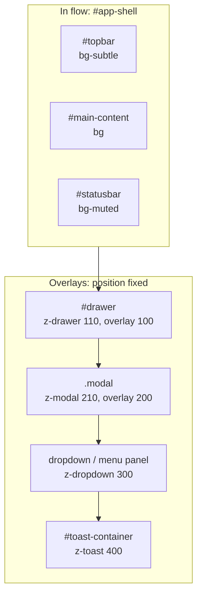
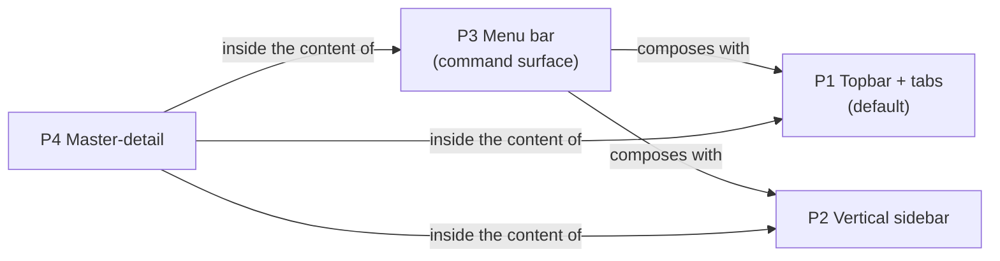

# Layout System - v4.2 (Electron)

> Companion layout reference, not a constraint. This file provides: (1) a **proposed default
> composition** and a **catalog of alternative composition patterns** (§12) that Claude co-designs
> from in Phase 3, the user amending or replacing freely;
> (2) the **feedback spec** (toasts, modals) serving the error contract; (3) **defaults and
> technical recommendations** (dimensions, behaviors) - never a composition restriction.
> The retained composition is the one validated in `docs/specs/03-surfaces.md` and locked in
> `docs/specs/04-architect.md`.
> Built on `design-system.md v2.1 (Electron)`. The two files are inseparable.

## Changelog

| Version | Date       | Main change |
| ------- | ---------- | ----------- |
| v4.2    | 2026-10-25 | design-system v2.1 alignment: **surface ladder** applied to every zone (topbar, menu bar, sidebar, master list on `--bg-subtle`; statusbar on `--bg-muted`; modal and drawer on `--bg-elevated`; canvas on `--bg`) · default hex refreshed · hover step transparent → `--border-strong` · control edge `--border-strong` · selected items carry a 2px `--primary` bar · pagination label and tree chevrons `--text-subtle` · tabs are a `<nav>` of buttons (`aria-current="page"`) · overlay behavior (dialog semantics, focus trap, `inert`, scroll lock, focus return) · drawer spans the bars actually mounted (`--shell-offset-top`) · toast roles (`alert` / `status`) · keyboard contracts for menu bar, table, tree · menu bar label padding `--spacing-1` · new size tokens |
| v4.1    | 2026-07-16 | design-system v2.0 alignment: sliding underline on tabs (signature gesture) · hover = border strengthening · Lucide icon names · durations 160/240ms `--ease-out` · no toast entry animations (motion policy) · floating layers (drawer, modal, menu panel) marked by `--border-strong` · default hex refreshed (accent-tinted neutrals) |
| v4.0    | 2026-07-14 | Composition pattern catalog (§12): vertical sidebar, menu bar, master-detail alternatives; Phase 3 becomes a guided co-design flow |
| v3.0    | 2026-07-13 | Non-binding composition: mandatory skeleton becomes the proposed default; caps become defaults/recommendations |
| v2.2    | 2026-07-02 | 6 toast positions (Phase 3 choice) · toast position preference - parity with the Python generator |
| v2.1    | 2026-06-14 | statusbar text `--text-subtle` (WCAG) · dark surface ramp · layering reference |
| v2.0    | initial    | Global structure, topbar, drawer, statusbar, recurring components |

Every generated application references the active version in its `README.md`.

## Deviations from v4.1

| Area | v4.1 | v4.2 | Reason |
| ---- | ---- | ---- | ------ |
| Topbar and menu bar fill | `--bg` | `--bg-subtle` | chrome sits one level above the canvas |
| Modal fill | `--bg` | `--bg-elevated` | floating layer, level N3 |
| Statusbar fill hex | `#EEF1F4` / `#293138` | `#E6EBF0` / `#2B343C` | recomputed neutral surfaces (`design-system.md §2`) |
| Hover on neutral items | transparent → `--border` | transparent → `--border-strong` | 3:1 hover rule |
| Pagination label | `--text-muted` | `--text-subtle` | informational text is not exempt from AA |
| Tree chevrons | `--text-muted` | `--text-subtle` | a functional icon is not exempt from AA |
| Selected item | fill and text color | plus a 2px `--primary` bar | WCAG 1.4.1 |
| Tabs | unspecified semantics | `<nav>` of buttons, `aria-current="page"` | no tab panel is switched in place |
| Tabs beyond 5 | `···` dropdown menu | the strip scrolls horizontally and keeps the current tab in view; the `···` menu is still recommended but not provided by the reference components | reference implementation limit |
| Menu bar label padding | `--spacing-2` vertical | `--spacing-1` vertical | a 14px label at 1.5 line-height needs 40px with `--spacing-2`; `--spacing-1` makes the bar measure its 32px token |
| Menu bar height | 32px | 32px **minimum** (`--menubar-height`) | the bar grows with the text |
| Right zone of the topbar | fixed 40px | `--spacing-2` padding around the 24px glyph + 1px border (= 40px) | built from tokens |
| Drawer extent | unspecified | between the bars actually mounted (`--shell-offset-top`, `--shell-statusbar`) | holds in P1, P2 and P3 |

---

## 1. GLOBAL STRUCTURE

Proposed default composition, submitted in Phase 3, amendable or replaceable by the user.

```
┌─────────────────────────────────────────────────────┐
│              TOPBAR (48px)                          │
│  [ Logo / Name ]  [ Nav tabs ]  [ Theme ]          │
├─────────────────────────────────────────────────────┤
│                                                     │
│            MAIN CONTENT                             │
│            (scrollable area)                        │
│                                                     │
├─────────────────────────────────────────────────────┤
│                STATUSBAR (28px)                     │
└─────────────────────────────────────────────────────┘
```

Proposed default HTML skeleton (`App.tsx` component):

```
<div id="app-shell">          column: topbar-height, 1fr, statusbar-height
  <header id="topbar">
  <main id="main-content">
  <footer id="statusbar">
  <div id="toast-container">  overlaid (position: fixed)
  <aside id="drawer">         overlaid (optional)
</div>
```

**Surface per zone** (`design-system.md §2`, surface ladder):

| Zone | Level | Fill | Edge |
| ---- | ----- | ---- | ---- |
| Main content, table bodies | N0 canvas | `--bg` | none |
| Topbar, menu bar, sidebar, master list | N1 chrome | `--bg-subtle` | 1px `--border` toward the canvas |
| Statusbar | N1 | `--bg-muted` | 1px `--border` above |
| Cards, grouped panels | N2 panel | `--bg-panel` | 1px `--border` |
| Dropdown, modal, drawer | N3 floating | `--bg-elevated` | 1px `--border-strong` |

**Stacking** (back to front, tokens from `design-system.md §13`):



**Right drawer** (optional, over the content):

```
┌─────────────────────────────────────────────────────┐
│                     TOPBAR                          │
├───────────────────────────────┬─────────────────────┤
│                               │                     │
│       MAIN CONTENT            │  DRAWER (320px)     │
│       (reduced)               │  sliding            │
│                               │                     │
├───────────────────────────────┴─────────────────────┤
│                   STATUSBAR                         │
└─────────────────────────────────────────────────────┘
```

**Toast** (overlaid, top-right corner):

```
┌─────────────────────────────────────────────────────┐
│                     TOPBAR              [ Toast 1 ] │
├─────────────────────────────────────────[ Toast 2 ]─┤
│                                                     │
│            MAIN CONTENT                             │
│                                                     │
├─────────────────────────────────────────────────────┤
│                   STATUSBAR                         │
└─────────────────────────────────────────────────────┘
```

Only `#main-content`, drawer content, modal content and lists scroll; the window itself does not. Mount the shell in a container that has a height (the window).

---

## 2. WINDOW (BrowserWindow)

Default values, customizable in Phase 3.

| Token / option    | Default |
| ----------------- | ------- |
| `minWidth`        | 1024 |
| `minHeight`       | 768 |
| position on launch | centered on the primary display; when the persisted-position preference is on and a position was saved, that saved position is restored instead (centering is the first-launch / preference-off fallback) |
| size on launch    | `WINDOW_DEFAULT_WIDTH`×`WINDOW_DEFAULT_HEIGHT` (1280×800); restored via the preference when enabled |
| theme on launch   | follows the OS theme (`nativeTheme.shouldUseDarkColors`) |
| OS default theme  | light |
| `show`            | `false` then `ready-to-show` (zero white flash) |
| `backgroundColor` | current theme `--bg` as a literal (the main process cannot read CSS): `#FFFFFF` light, `#111519` dark (anti-flash) |
| `autoHideMenuBar` | `true`: no native Windows menu |
| `webPreferences`  | locked, see `rules/security.md` |
| `icon`            | `resources/icon.ico` (provided by the user, otherwise Electron default) |

---

## 3. TOPBAR

| Token              | Default |
| ------------------ | ------- |
| height             | `--topbar-height` = 48px (minimum: the bar grows with the text) |
| level              | N1 chrome |
| light mode bg      | `--bg-subtle` = #F1F4F7 |
| dark mode bg       | `--bg-subtle` = #1A2025 |
| bottom border      | 1px `--border` |
| horizontal padding | `--spacing-4` = 16px |

### Topbar zones (left → right)

```
[ Logo / App name ]  [ Navigation tabs ]  ···  [ Theme ]
```

| Zone   | Content                   | Width |
| ------ | ------------------------- | ----- |
| Left   | SVG logo 24px + app name  | fixed |
| Center | Navigation tabs (`<nav>`) | flexible |
| Right  | Light/dark theme selector | fixed, 40px (`--spacing-2` padding around the 24px glyph + 1px border) |

### Logo / App name

- SVG icon `--icon-lg` (24px) + label `--weight-semibold` `--font-base` (16px).
- Color: `--text`.
- Not clickable. No logo is imposed: without one, set the product name in plain type.

### Navigation tabs (`<nav id="topbar-tabs">`)

- A `<nav>` (with an accessible name, default "Navigation principale") of `<button class="tab">` buttons - never `<a href>` (technical constraint: no real navigation, single-page app). The current tab carries `aria-current="page"`. This is not the ARIA tab pattern: no `tablist`, `tab` or `tabpanel`.
- Embedded in the topbar, center-aligned.
- 5 visible tabs recommended at most. Beyond 5, the strip scrolls horizontally and keeps the current tab in view; a `···` dropdown menu remains the recommended pattern but is not provided by the reference components.
- Labels never wrap (`white-space: nowrap`).
- Active tab (`.is-active`): `--primary` text; the selected indicator is the **signature underline**, a 2px `--primary` underline positioned on the tabs container (`::after`) that slides to the active tab in 240ms `--ease-out` (`design-system.md §8`). It starts after the first placement (no growth from zero on mount), follows size changes (`ResizeObserver`), snaps under `prefers-reduced-motion`, and takes `Highlight` in forced-colors mode.
- Inactive tab: `--text-subtle` text, transparent background, 1px transparent border.
- Hover: border strengthening, transparent border → `--border-strong` (`design-system.md §8`), `--transition-default` transition. Press: `--bg-muted`.
- Focus ring drawn inset (the strip scrolls and would clip an outer ring).
- Font: `--weight-medium` `--font-sm` (14px).
- Tab height: fills the topbar (minimum `--topbar-height` = 48px).
- Horizontal padding per tab: `--spacing-4` = 16px.
- Active content rendered by React (state `activeTab`) - a single tab mounted at a time.
- `Alt+1…9` jumps to tab N (§9).

### Theme selector

- Icon only (Lucide `Moon` in light, `Sun` in dark), size `--icon-lg` = 24px.
- Mandatory `title` **and** `aria-label`: "Passer en mode sombre" / "Passer en mode clair".
- Instant toggle - `data-theme` switched on `<html>` + persisted in preferences via IPC.

---

## 4. MAIN CONTENT AREA

| Token             | Default |
| ----------------- | ------- |
| level             | N0 canvas |
| light mode bg     | `--bg` = #FFFFFF |
| dark mode bg      | `--bg` = #111519 |
| inner padding     | `--spacing-6` = 24px |
| scroll            | vertical, `overflow-y: auto` |
| max content width | `--content-xl` = 1024px (centered) |

A master-detail content (P4) is mounted flush: no padding, no maximum width.

### Section header

```
[ Section title ]   [ Subtitle / short description ]
```

- One per view, at the top of `#main-content`. Not used inside a modal or drawer (those carry their own `--font-lg` title).
- Title: `--weight-bold` `--font-2xl` (24px), `--leading-tight`, color `--text`.
- Subtitle: `--weight-normal` `--font-sm` (14px), color `--text-subtle`.
- Bottom margin: `--spacing-6` = 24px before the content.

---

## 5. TOAST

Fully replaces the inline banner. No inline banner in the applications.
Component: `views/ToastManager.tsx` - queue in React state, `#toast-container` container in `position: fixed`.

### Position - Phase 3 choice

6 positions available. Default: `top-right`.

| Position        | Anchor          | CSS class on `#toast-container` |
| --------------- | --------------- | ------------------------------- |
| `top-right`     | top + right     | `toast-stack-top-right` |
| `top-left`      | top + left      | `toast-stack-top-left` |
| `top-center`    | top + center    | `toast-stack-top-center` |
| `bottom-right`  | bottom + right  | `toast-stack-bottom-right` |
| `bottom-left`   | bottom + left   | `toast-stack-bottom-left` |
| `bottom-center` | bottom + center | `toast-stack-bottom-center` |

> Motion policy (`design-system.md §6`): **no entry/exit animation** - toasts appear and disappear instantly, and the stack reflows without transition. The only expressive movement in the system is the signature underline.

### Margins and stacking

| Token                          | Value |
| ------------------------------ | ----- |
| width                          | `--toast-width` = 320px (fixed) |
| margin from edge               | `--spacing-4` = 16px |
| margin from topbar / statusbar | `--spacing-4` = 16px (per top/bottom anchor), measured from the bars actually mounted (`--shell-offset-top`, `--shell-statusbar`) |
| spacing between toasts         | `--spacing-2` = 8px |
| stacking                       | Vertical, queue, no overlap |
| stacking direction (top)       | new toast on top, older ones descend (newest first in the DOM) |
| stacking direction (bottom)    | new toast at bottom, older ones rise (newest last in the DOM) |

### Implementation

- The `ToastManager` (`views/ToastManager.tsx`) anchors `#toast-container` per `TOAST_POSITION`.
- `TOAST_POSITION` (`src/shared/config.ts`) = `"top-right"` by default, modified per Phase 3 choice.
- Each anchor is a named CSS rule in `styles.css` (position classes on `#toast-container` - no inline style, `@rules/css.md`).
- The consumer owns the timers.

### Display durations

| Type      | Duration   | Manual dismiss    | ARIA role |
| --------- | ---------- | ----------------- | --------- |
| `success` | 4s         | No                | `status` |
| `info`    | 4s         | No                | `status` |
| `warning` | 6s         | Yes (×)           | `status` |
| `danger`  | persistent | Yes (×) mandatory | `alert` |

### Toast anatomy

```
┌────────────────────────────────────┐
│ [icon]  Main message           [×] │
│         Optional description       │
└────────────────────────────────────┘
```

| Token            | Value |
| ---------------- | ----- |
| padding          | `--spacing-3` vertical, `--spacing-4` horizontal |
| left border      | 4px (`--border-width-accent`) semantic color, no other border |
| bg               | semantic bg (`--*-50`) |
| radius           | `--radius` |
| message font     | `--weight-medium` `--font-sm` (14px), color `--text` |
| description font | `--weight-normal` `--font-xs`, `--text-subtle` |
| icon             | `--icon-md` = 20px |

| Type      | Bg             | Border          | Icon (Lucide)   |
| --------- | -------------- | --------------- | --------------- |
| `success` | `--success-50` | `--success-600` | `CircleCheck`   |
| `warning` | `--warning-50` | `--warning-600` | `TriangleAlert` |
| `danger`  | `--danger-50`  | `--danger-600`  | `CircleX`       |
| `info`    | `--info-50`    | `--info-600`    | `Info`          |

> `--*-50` is the toast surface role: pale tint in light, deep tint in dark (redefined in `[data-theme="dark"]`, see `design-system.md §2`). Info takes the accent itself (`--primary-bg` surface, `--primary` edge and icon). Toast message text uses `--text`, never the tone color. Toast icons use the matching `--icon-*` token. The icon shape repeats the tone, so color never carries the status alone.
> Layering: `#toast-container` uses `--z-toast` (400), above modals (`design-system.md §13`), so a persistent `danger` toast is never hidden.

---

## 6. RIGHT DRAWER

Optional component. Default values below.

| Token         | Default |
| ------------- | ------- |
| level         | N3 floating layer |
| width         | `--drawer-width` = 320px; shrinks to the window width on a narrow window |
| animation     | slide from the right, `--transition-slow` = 240ms (`transform: translateX`) |
| light mode bg | `--bg-elevated` = #FFFFFF |
| dark mode bg  | `--bg-elevated` = #222930 |
| left border   | 1px `--border-strong` (floating layer, `design-system.md §5`) |
| padding       | `--spacing-6` = 24px |
| overlay bg    | `--text` at `--opacity-overlay` (40%) |
| extent        | between the bars actually mounted: top at `--shell-offset-top` (menu bar + topbar), bottom at `--shell-statusbar` |

- Opened by explicit action only. Never automatically.
- Close: click overlay, Escape key, or × button in the drawer.
- Drawer header: `--weight-semibold` `--font-lg` (18px) title + × button aligned right.
- Drawer content: vertically scrollable on overflow.
- Behavior while open (`role="dialog"`, `aria-modal`, named by the title through `aria-labelledby`): focus moves in (first focusable of the content, else the close button); Tab and Shift+Tab stay inside; the page behind is `inert` (the toast stack stays reachable) and does not scroll; focus returns to the opener on close.
- Layers: overlay `--z-drawer-overlay`, drawer `--z-drawer`.
- Not combined with a master-detail pane: the detail pane makes it redundant.

---

## 7. STATUSBAR

Default values below.

| Token              | Default |
| ------------------ | ------- |
| height             | `--statusbar-height` = 28px |
| level              | N1 chrome, one step darker than the topbar |
| light mode bg      | `--bg-muted` = #E6EBF0 |
| dark mode bg       | `--bg-muted` = #2B343C |
| top border         | 1px `--border` |
| horizontal padding | `--spacing-4` = 16px |
| font               | `--weight-normal` `--font-xs`, tabular digits |
| text color         | `--text-subtle` |

> WCAG: `--text-subtle` on `--bg-muted` measures 4.90:1 in light and 5.61:1 in dark (AA 4.5:1). Essential or error status uses `--text` for full contrast. `--text-muted` is reserved for disabled/decorative use (see `design-system.md §12`).

### Statusbar zones (left → right)

```
[ Status message ]  ···  [ Progress ]  [ Contextual info ]
```

| Zone   | Content |
| ------ | ------- |
| Left   | Current status message ("Prêt", "Chargement…", "3 éléments sélectionnés") |
| Center | Compact native `<progress>` (8px = `--spacing-2`, accent `--primary`) - visible only when an operation is running |
| Right  | Fixed contextual info (record count, version, DB connection…) |

---

## 8. RECURRING COMPONENTS

### Data table (`<table class="data-table">`)

- Body on `--bg` (N0). When the table sits on a panel (N2), frame it with a 1px `--border`; never place the body on `--bg-subtle`.
- Header: `--bg-subtle` bg, `--weight-semibold` `--font-sm`, `--text-subtle`, `scope="col"`.
- Header bottom border: 2px `--border-strong`.
- Row: dynamic height (vertical padding `--spacing-2` = 8px), cell horizontal padding `--spacing-3`, 1px `--border-subtle` bottom border.
- Columns: dynamic width (`table-layout: auto`). Exception: actions column - fixed width per content.
- Numeric columns: right aligned, `font-variant-numeric: tabular-nums`.
- Column sorting: clicking a sortable column header sorts by that column; a second click reverses the order (ascending, then descending). The active column shows a Lucide `ChevronUp` (ascending) or `ChevronDown` (descending) `--icon-sm` indicator and carries `aria-sort`; other columns show none. One sort column at a time. Data columns are sortable by default; a presentational column such as the actions column is not. Digits inside text sort numerically ("2" before "10").
- Selected row (`.is-selected`): `--primary-bg` bg **plus a 2px `--primary` bar** on the leading edge of the first cell.
- Row hover: bottom border strengthens `--border-subtle` → `--border`, plus the `--bg-subtle` secondary cue allowed on wide rows (`design-system.md §8`).
- Row alternation: disabled (uniform surfaces, depth by stroke).
- Keyboard (rows selectable): one tab stop in the body (roving tabindex); Up, Down, Home and End move between rows; Enter or Space select; the row carries `aria-selected`. A click on a button or link inside a row does not select the row.
- Row actions are named with their row (e.g. `aria-label="Supprimer Dupont"`): a bare "Supprimer" repeated down the column is not usable with a screen reader. The table takes an accessible `label`.
- Pagination below the table recommended beyond ~50 rows.

### Input form

- Labels above the fields (`<label>` linked via `htmlFor`; the field `id` is required), `--weight-medium` `--font-sm`, `--text`. Never beside or inside the field.
- Fields: `width: 100%` in their container, dynamic height (vertical padding `--spacing-2` = 8px), horizontal padding `--spacing-3`.
- Field edge: 1px `--border-strong` at rest (control edge, 3:1), `--text-subtle` on hover, focus ring 2px `--primary` offset 2px.
- Spacing between fields: `--spacing-4` = 16px.
- Field in error (`.has-error`): 2px `--danger-600` border (padding shrinks by 1px so the field does not grow) + `--danger-600` message below the field, `--font-xs`. An error is never signalled by color alone: always write the message.
- Form actions: aligned right - Cancel (`.btn-secondary`) + Confirm (`.btn-primary`), dynamic width per label.
- Submission via `onSubmit` + `preventDefault` - never navigation.

### Tree view (`<ul class="tree">`)

- Indentation per level: `--spacing-4` = 16px (same step at every level).
- Expand/collapse icon: Lucide `ChevronRight` / `ChevronDown`, `--icon-sm` = 16px, `--icon-default` (`--text-subtle`). A leaf keeps a blank slot of the same width.
- Item height: dynamic (vertical padding `--spacing-1` = 4px).
- Selected item (`.is-selected`): `--primary-bg` bg **plus a 2px `--primary` bar** on the leading edge. Never the underline.
- Hover: item border from transparent to `--border-strong`; press `--bg-muted`.
- Semantics: `role="tree"`, nodes `role="treeitem"` with `aria-selected` and `aria-expanded`. Clicking a parent toggles it and selects it.
- Keyboard (APG tree): one tab stop (roving tabindex); Up and Down move, Home and End jump, Right expands or enters the first child, Left collapses or goes to the parent, Enter or Space act like a click. The focus ring is drawn inset on the row.

### Charts / Visualization

- Background: transparent (inherits the main content).
- Palette: `--chart-primary`, `--chart-success`, `--chart-warning`, `--chart-danger`, `--chart-info`.
- Hue alone never separates two series: add a marker shape, a dash pattern or a direct label; keep ≥ 1.5:1 of lightness between neighbouring series. `--chart-info` equals `--chart-primary`: never plot both in one chart.
- Legend: `--weight-normal` `--font-sm`, `--text-subtle`.
- No shadow (`design-system.md §5` - depth by stroke).
- Chart library: to validate in Phase 1 (none by default).

### Modal

```
┌─────────────────────────────────────┐
│  Modal title                    [×] │
├─────────────────────────────────────┤
│                                     │
│  Content (form, text…)              │
│                                     │
├─────────────────────────────────────┤
│              [ Cancel ] [ Confirm ] │
└─────────────────────────────────────┘
```

Controlled React component (state `isOpen`) - `<div class="modal-overlay"><div class="modal">`.

| Token         | Default |
| ------------- | ------- |
| level         | N3 floating layer |
| width         | dynamic per content, min `--modal-min-width` = 480px (never wider than the window) |
| light mode bg | `--bg-elevated` = #FFFFFF |
| dark mode bg  | `--bg-elevated` = #222930 |
| border        | 1px `--border-strong` (floating layer, `design-system.md §5`) |
| radius        | `--radius` |
| padding       | `--spacing-6` = 24px |
| overlay bg    | `--text` at `--opacity-overlay` (40%) |
| layers        | overlay `--z-modal-overlay`, modal `--z-modal` |

- Opened by explicit action only.
- Close: × button, Cancel, Escape key, or click overlay.
- Header: `--weight-semibold` `--font-lg` title + × button on the right, 1px `--border-subtle` bottom border.
- Footer: actions on the right - Cancel (secondary) then Confirm (primary, or danger for a destructive action), 1px `--border-subtle` top border.
- Content: vertically scrollable on overflow.
- Zero `alert()` / `confirm()` / `dialog.showMessageBox` - always this styled modal.
- Behavior while open (`role="dialog"`, `aria-modal`, named by the title through `aria-labelledby`): focus moves in (first focusable of the content, else Cancel); Tab and Shift+Tab stay inside; the page behind is `inert` (the toast stack stays reachable) and does not scroll; focus returns to the opener on close. With several overlays open, only the top one reacts to Escape.

### Pagination

Shown below a table when it grows long - beyond ~50 rows by default.

```
[ ← ]  [ 1 ]  [ 2 ]  [ 3 ]  ···  [ 12 ]  [ → ]
                  Page 2 sur 12
```

| Token              | Default |
| ------------------ | ------- |
| position           | below the table, aligned right |
| spacing from table | `--spacing-4` = 16px |
| page button        | dynamic per number, padding `--spacing-2` horizontal; `aria-label` "Page N" |
| active button      | `--primary-bg` bg, `--primary` text, 2px `--primary` bar on the bottom edge, `aria-current="page"` |
| inactive button    | transparent, `--text-subtle` text, 1px transparent border |
| button hover       | border strengthening, transparent → `--border-strong` (`design-system.md §8`) |
| ← → buttons        | `--icon-sm` chevrons, disabled on first/last page |
| page label         | `--weight-normal` `--font-xs`, `--text-subtle`, centered, `role="status"` so a page change is announced |
| visible pages      | 5 numbers by default (first, last and the neighbors of the current page) - `···` ellipsis for the gaps |

Nothing renders when the page count is below 1.

---

## 9. GLOBAL KEYBOARD NAVIGATION

Default shortcuts - customizable in Phase 3.

| Shortcut            | Action |
| ------------------- | ------ |
| `Tab` / `Shift+Tab` | Navigate between interactive elements |
| `Enter` / `Space`   | Activate focused button / item |
| `Escape`            | Close active drawer / modal / dropdown (only the top overlay reacts) |
| `Alt+1…9`           | Direct navigation to tab N |
| `Ctrl+,`            | Open Settings |

- `Alt+1…9` is matched on the **physical digit key** (`event.code` `Digit1`…`Digit9`), so it works on AZERTY layouts. It is disabled while a modal or drawer is open.
- Inside an open modal or drawer, Tab and Shift+Tab are trapped in the overlay.

Component-level contracts:

| Component | Keys |
| --------- | ---- |
| Data table (selectable rows) | one tab stop; Up, Down, Home, End move; Enter, Space select |
| Tree | one tab stop; Up, Down, Home, End move; Right expands or enters; Left collapses or goes to parent; Enter, Space act like a click |
| Menu bar (P3) | see §12, P3 |

Implementation: `keydown` listeners in the renderer. Global shortcuts do not go through `globalShortcut` (reserved for out-of-focus shortcuts, not required here).

---

## 10. PERSISTED PREFERENCES

`preferences.json` file in `app.getPath("userData")` - read/written **only by the main process** (`preferences.model.ts`), exposed to the renderer via IPC.

| Preference         | Default value |
| ------------------ | ------------- |
| theme              | OS system |
| window size        | 1280×800 |
| window position    | centered |
| drawer state       | closed |
| sidebar collapsed (P2) | expanded |
| language (if i18n) | fr |
| toast position     | top-right |

---

## 11. DESIGN SYSTEM CROSS-REFERENCE

This file does not redefine tokens - it consumes them. Every visual value is traced to `design-system.md v2.1 (Electron)`.

| Need                       | Token |
| -------------------------- | ----- |
| Canvas (content, table bodies) | `--bg` |
| Chrome (topbar, menu bar, sidebar, master list) | `--bg-subtle` |
| Statusbar, open-menu label, press feedback | `--bg-muted` |
| Panels and cards            | `--bg-panel` |
| Floating layers (drawer, modal, menu panel) | `--bg-elevated` |
| Primary text               | `--text` |
| Secondary text, statusbar, pagination label | `--text-subtle` |
| Disabled / decorative only | `--text-muted` |
| Borders                    | `--border` / `--border-subtle` / `--border-strong` |
| Control edge (field, Secondary button) | `--border-strong` |
| Active / selection color   | `--primary` / `--primary-bg` + 2px `--primary` bar |
| Danger button fill         | `--danger-fill` |
| Focus                      | `--focus-ring` 2px offset 2px |
| Easing                     | `--ease-out` cubic-bezier(0.2, 0.8, 0.2, 1) |
| Panel transitions          | `--transition-slow` = 240ms (`--duration-slow`) |
| State transitions          | `--transition-default` = 160ms (`--duration-default`) |
| Shape                      | `--radius` = 5px (nested: `calc(var(--radius) - 2px)`) |
| Shadows                    | none - floating layers marked by `--border-strong` |
| Line-height                | `--leading-tight` 1.25 / `--leading-normal` 1.5 |
| Overlay opacity            | `--opacity-overlay` 0.4 (`--text` color) |
| Stacking order             | `--z-*` layering scale (`design-system.md §13`) |
| Fixed layers between bars  | `--shell-offset-top`, `--shell-statusbar` (`design-system.md §4`) |
| Pattern sizes              | `--sidebar-width`, `--master-width`, `--menubar-height`, `--menu-min-width` |
| Feedback sizes             | `--toast-width`, `--modal-min-width`, `--drawer-width` |

---

## 12. COMPOSITION PATTERNS

Catalog of alternative composition patterns for the Phase 3 co-design flow. The default composition (§1-§10) is pattern **P1**. Each pattern below is a starting point the user may amend or replace; dimensions are defaults. The retained composition is recorded in `docs/specs/03-surfaces.md` and locked in `docs/specs/04-architect.md`. The feedback spec (§5 toasts, §8 modals) applies to every pattern.



### P1 - Topbar + tabs (default)

Horizontal navigation embedded in the topbar - the composition proposed by default in Phase 3.

**Structure**: see §1 (shell, drawer, toast overlay) and §3 (topbar zones, tabs, theme selector). Not repeated here.

| Element         | Default |
| --------------- | ------- |
| topbar          | `--topbar-height` = 48px, `--bg-subtle` - §3 |
| navigation tabs | centered in the topbar, 5 visible at most (scroll beyond) - §3 |
| statusbar       | `--statusbar-height` = 28px, `--bg-muted` - §7 |

**When to recommend**: 2-5 top-level views of comparable weight, flat hierarchy, no sub-navigation.

**Implementation notes**: anchors `#app-shell`, `#topbar`, `#topbar-tabs`, `#main-content`, `#statusbar` (§1). A single tab is mounted at a time (React `activeTab` state).

**Interactions**: toasts (§5), drawer (§6), statusbar (§7), and modals (§8) unchanged. Master-detail (P4) may be used inside a tab.

### P2 - Vertical sidebar

Left navigation column - for many sections, or sections carrying sub-items.

**Structure**

```
┌──────────┬──────────────────────────────────────────┐
│ SIDEBAR  │        TOPBAR (reduced, optional)        │
│ (240px)  ├──────────────────────────────────────────┤
│          │                                          │
│ [ico] …  │            MAIN CONTENT                  │
│ [ico] …  │            (scrollable area)             │
│ [ico] …  │                                          │
├──────────┴──────────────────────────────────────────┤
│                 STATUSBAR (28px)                    │
└─────────────────────────────────────────────────────┘
```

Proposed HTML skeleton (`App.tsx` component):

```
<div id="app-shell">          sidebar column (240px) beside topbar + content; statusbar spans the full width
  <nav id="sidebar">
  <header id="topbar">        reduced (title + global actions) - optional
  <main id="main-content">
  <footer id="statusbar">
  <div id="toast-container">  overlaid (position: fixed)
  <aside id="drawer">         overlaid (optional)
</div>
```

| Element               | Default |
| --------------------- | ------- |
| width (expanded)      | `--sidebar-width` = 240px (never more than 40% of a narrow window) |
| width (collapsed)     | icons only - `--icon-lg` + `--spacing-4` padding on each side |
| bg                    | `--bg-subtle` (N1 chrome) |
| right border          | 1px `--border` |
| item                  | icon `--icon-md` (20px) + label `--weight-medium` `--font-sm` (14px) |
| item label            | word-wraps within the 240px width (`white-space: normal; overflow-wrap: anywhere`), never truncated or ellipsized, so long labels stay fully visible |
| item vertical padding | `--spacing-2` = 8px |
| active item           | `--primary` text, `--primary-bg` background, **2px `--primary` bar on the leading edge** (`design-system.md §8` - vertical nav has no underline) |
| inactive item         | `--text-subtle` text, transparent background, 1px transparent border |
| hover                 | border strengthening, transparent → `--border-strong` (`design-system.md §8`), `--transition-default` |
| collapsed item        | carries its label as `title` |
| collapse toggle       | optional - state persisted like the drawer (§10) |
| topbar (if kept)      | reduced to app name + global actions (theme), `--topbar-height` = 48px |

**When to recommend**: more than 5 top-level views; grouped sections or sub-items; long labels that would crowd a topbar; a navigation the user wants always visible.

**Implementation notes**: anchor `#sidebar` (`<nav>`), items are `<button class="nav-item">` - never `<a href>` (technical constraint: single-page app, no real navigation, same as §3). `#app-shell` becomes a 2-column grid. The collapsed state is a persisted preference (§10), like the drawer.

**Interactions**: toasts (§5) keep their 6 positions and their margins; the drawer (§6) still overlays the content; the statusbar (§7) spans the full width. Master-detail (P4) may compose inside `#main-content`.

### P3 - Menu bar

A classic File/Edit/View command bar above the content - for command-driven, document-oriented apps.

**Structure**

```
┌─────────────────────────────────────────────────────┐
│  File   Edit   View   Help          MENU BAR (32px) │
├─────────────────────────────────────────────────────┤
│              TOPBAR (optional)                      │
├─────────────────────────────────────────────────────┤
│            MAIN CONTENT                             │
│            (scrollable area)                        │
├─────────────────────────────────────────────────────┤
│                STATUSBAR (28px)                     │
└─────────────────────────────────────────────────────┘
```

| Element          | Default |
| ---------------- | ------- |
| height           | `--menubar-height` = 32px (minimum: the bar grows with the text) |
| bg               | `--bg-subtle` (N1 chrome) |
| bottom border    | 1px `--border` |
| menu label       | `--weight-medium` `--font-sm` (14px), `--text` |
| label padding    | `--spacing-1` vertical, `--spacing-3` horizontal (31px label + 1px border = 32px) |
| label hover      | border strengthening, transparent → `--border-strong` (`design-system.md §8`) |
| label open       | `--bg-muted` background (open-state feedback) |
| open panel       | `--bg-elevated` bg, 1px `--border-strong` (floating layer), `--radius`, min-width `--menu-min-width` = 200px |
| panel item       | `--font-sm`, padding `--spacing-2` / `--spacing-4`, hover border strengthening; nested radius `calc(var(--radius) - 2px)` |
| separator        | 1px `--border-subtle` |
| disabled item    | `--text-muted`, `aria-disabled="true"`: stays focusable, does not run |
| layering         | `--z-dropdown` (`design-system.md §13`) - never a hardcoded value |

**Keyboard (APG menubar)**: one tab stop on the labels (roving tabindex); Left and Right move between labels (and open the neighbor when a menu is open); Down, Up or Enter open the menu and focus its first or last item; Up and Down, Home and End move in the panel; a letter jumps to the next item starting with it; Escape closes and returns to the label; Left and Right in a panel open the adjacent menu; Tab closes. The bar takes an accessible `label`.

**When to recommend**: many commands for few views (editor, document tool, admin console); actions that do not map onto navigation tabs; users expecting the File/Edit/View convention.

**Implementation notes**: anchor `#menubar`. **Technical constraint**: this is a custom in-app menu styled with tokens, not the native OS menu - the native `Menu` cannot be styled and would break the design system, so `autoHideMenuBar: true` stays (§2). Panels open on click, close on Escape / outside click (§9), and read the `--z-*` tokens (no inline style, `@rules/css.md`). Menu items dispatch to renderer state or `window.api` - never to an Electron `role`-based native menu.

**Interactions**: toasts (§5), drawer (§6), statusbar (§7), and modals (§8) unchanged. The menu bar is a **command** surface: it composes with a navigation surface (tabs P1 or sidebar P2) rather than replacing it. Commands do not belong in the topbar.

### P4 - Master-detail

List panel + detail panel - for one dominant entity browsed and inspected item by item.

**Structure**

```
┌─────────────────────────────────────────────────────┐
│                     TOPBAR                          │
├────────────────────┬────────────────────────────────┤
│  MASTER LIST       │  DETAIL PANE                   │
│  (320px)           │  (flexible)                    │
│  [ item ]          │  [ title + item actions ]      │
│  [ item selected ] │  [ fields / sections ]         │
│  [ item ]          │                                │
├────────────────────┴────────────────────────────────┤
│                   STATUSBAR                         │
└─────────────────────────────────────────────────────┘
```

| Element             | Default |
| ------------------- | ------- |
| master list width   | `--master-width` = 320px (never more than 50% of a narrow window) |
| resizable split     | optional - 4px drag handle, `--border` (not provided by the reference components) |
| list bg             | `--bg-subtle` (N1 chrome) |
| separator           | 1px `--border` |
| list item padding   | `--spacing-2` vertical, `--spacing-4` horizontal |
| list item separator | 1px `--border-subtle` |
| selected item       | `--primary-bg` background **plus a 2px `--primary` bar** on the leading edge (same role as the table row, §8) |
| item hover          | border strengthening, transparent → `--border-strong`. The `--bg-subtle` secondary cue has no effect on a `--bg-subtle` list, so hover shows by border only |
| detail padding      | `--spacing-6` = 24px |
| empty state         | centered message, `--text-subtle` `--font-sm` |
| list header actions | add / refresh - top of the list panel |

**When to recommend**: a dominant entity listed and inspected/edited one at a time (records, orgs, files); the user needs the list and the detail visible together; it replaces the table → modal round trip.

**Implementation notes**: anchors `#master-list` and `#detail-pane`, two zones inside `#main-content` (flex or grid), mounted flush (§4). Selection lives in React state; the detail pane renders the selected id and an explicit empty state when nothing is selected. Item actions live in the detail header, list-level actions in the list header.

**Interactions**: composes inside the content area of P1, P2, or P3. Toasts (§5) and modals (§8) unchanged - a destructive confirmation stays a styled modal (§8). The right drawer (§6) is usually redundant with the detail pane: pick one.
